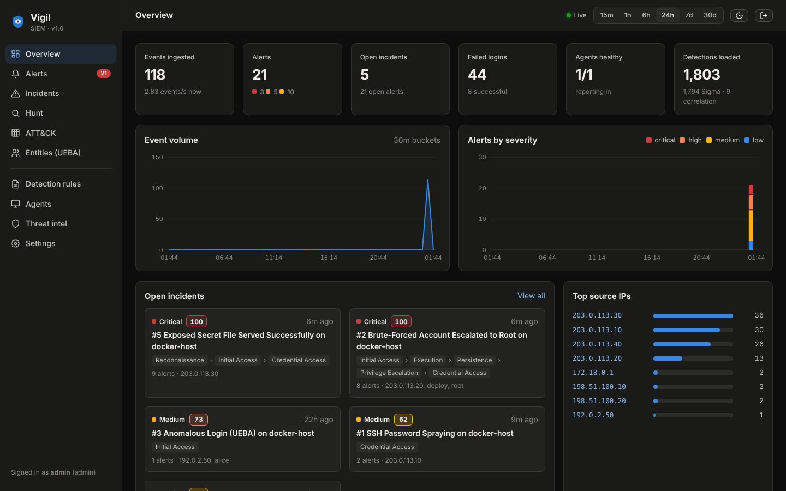
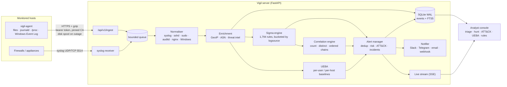
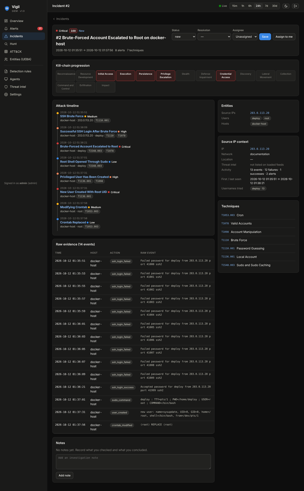
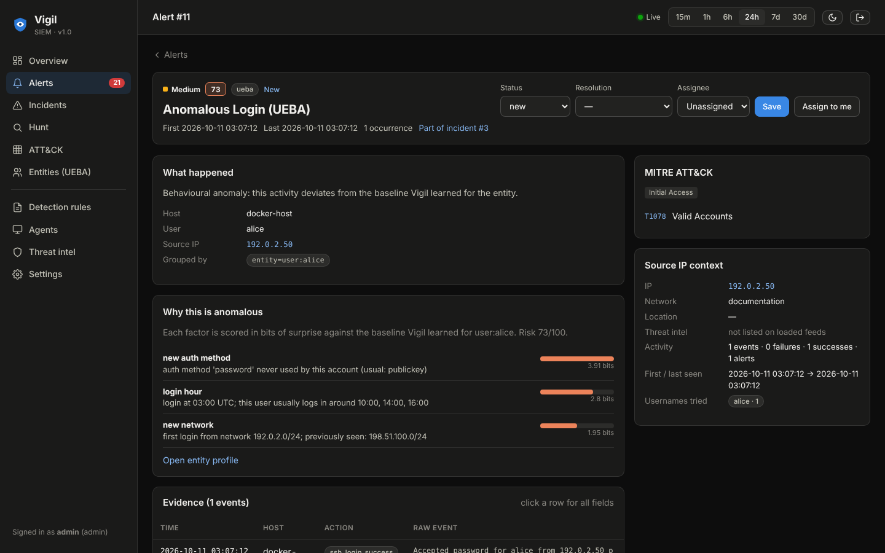
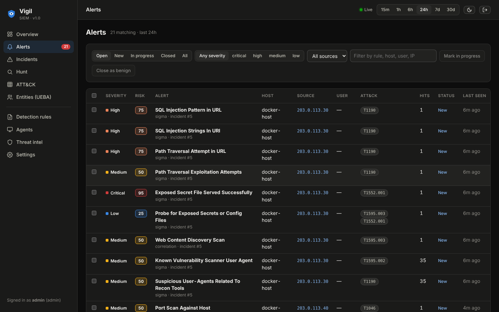
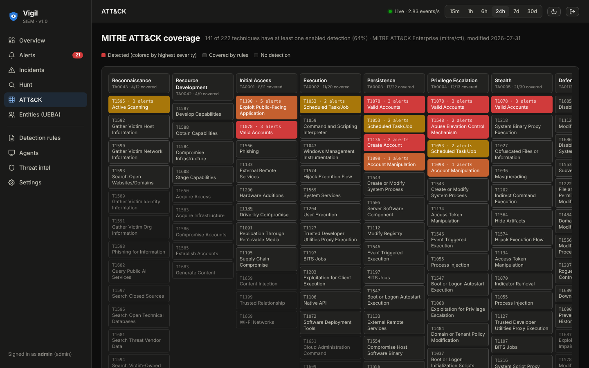
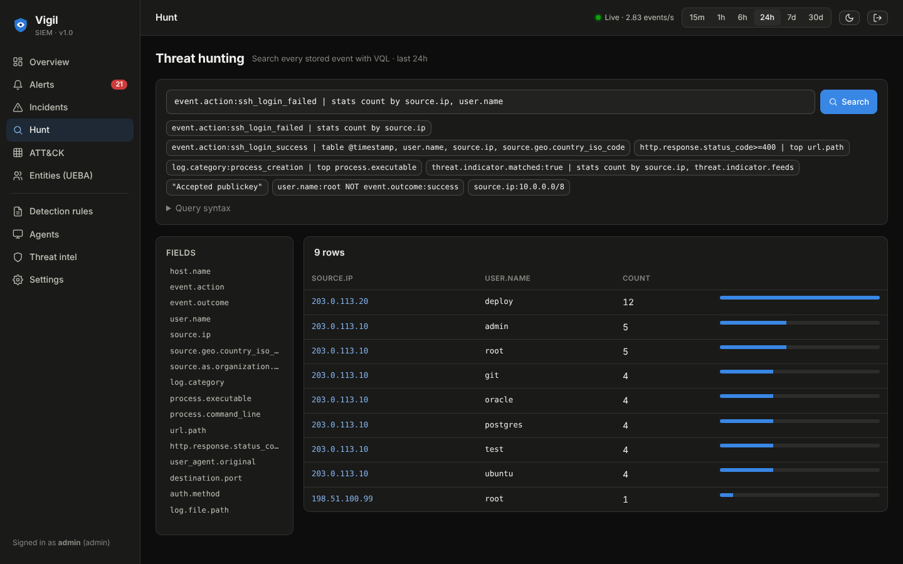
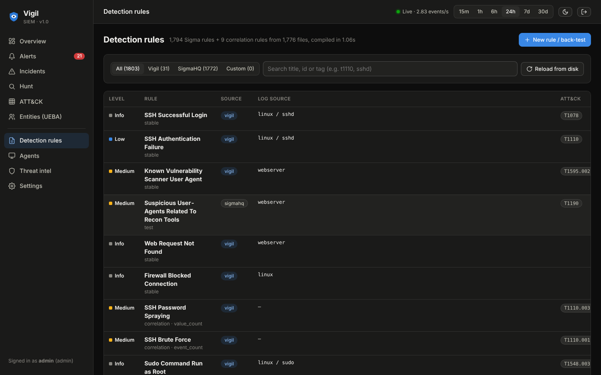
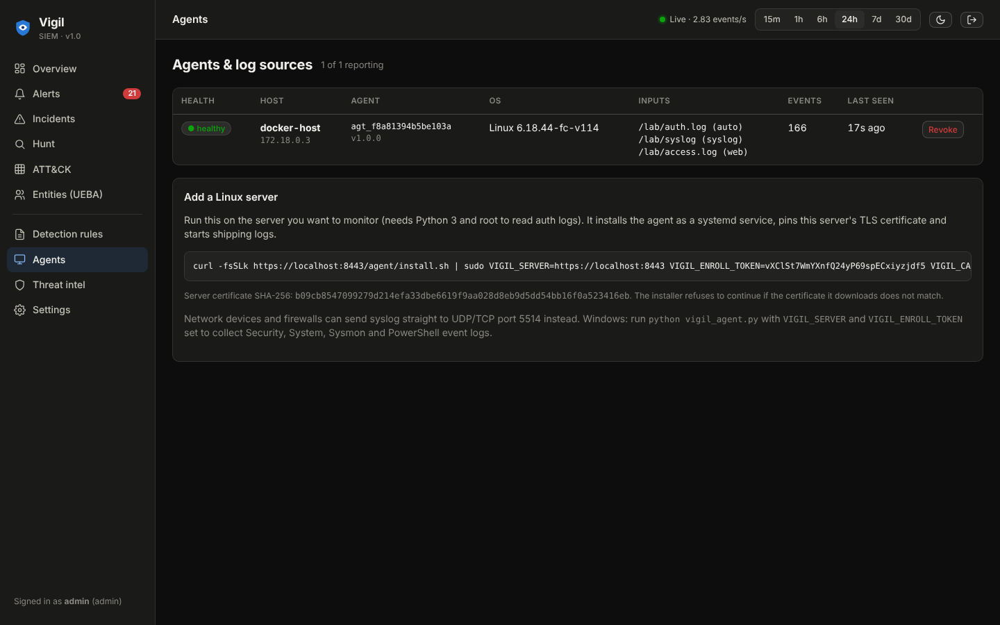

# Vigil SIEM

A self-hosted security monitoring platform for Linux servers, web servers and Windows hosts. A lightweight agent collects
logs, the server normalises them, runs **1,794 Sigma rules plus multi-stage correlation rules**, maps every alert to
**MITRE ATT&CK**, enriches IPs with offline GeoIP and free threat-intel feeds, learns per-user and per-host
**behavioural baselines (UEBA)**, and groups related alerts into incidents that an analyst triages in a web console.

One command brings it up:

```bash
./vigil.sh up      # build, start, print the console URL and a generated admin password
./vigil.sh demo    # replay sample log activity so every detection type fires
```



> Screenshots were taken from the Docker deployment after `./vigil.sh demo`. The demo writes ordinary log lines
> (OpenSSH, sudo, useradd, cron, UFW, nginx) that use only the RFC 5737 documentation address ranges, so no real
> address is labelled as hostile.

---

## What it does

| Area | Details |
|---|---|
| **Collection** | Single-file Python agent (stdlib only). Tails files with rotation and truncation handling, follows journald with a cursor, watches new processes through `/proc`, and reads Windows Event Logs (Security, System, Sysmon, PowerShell). Batches are gzip-compressed over HTTPS with a per-agent token and spooled to disk when the server is down, so delivery is at-least-once. Firewalls and appliances can send syslog to UDP/TCP 5514. |
| **Parsing** | RFC 3164, RFC 5424 and ISO syslog; OpenSSH, PAM, sudo, su, useradd/usermod/groupadd, cron, UFW/iptables, systemd-logind; nginx/Apache combined and JSON access logs; auditd (multi-record assembly into process events); Windows XML events and Sysmon. Everything is normalised to ECS-style fields. |
| **Detection** | An in-memory Sigma engine (all modifiers including `cidr`, `re`, `base64offset`, `windash`, `fieldref`, `exists`, numeric comparisons and the full condition grammar). Ships 1,794 SigmaHQ rules for Linux, web and Windows plus Vigil's own rules. |
| **Correlation** | Sigma v2 correlation rules: `event_count`, `value_count`, `temporal` and `temporal_ordered`, with aliases and chaining. This is how Vigil detects brute force, password spraying, distributed brute force, port scans, "successful login after brute force" and "brute-forced account escalated to root". |
| **UEBA** | Baselines are learned from your own logs; there is no pre-trained model and no synthetic training data. It scores login hour, new country, ASN, network, host and auth method per user, impossible travel, rare executables and parent→child process lineage per host, and event-rate spikes. Each factor is reported in bits of surprise with a plain-English reason. |
| **Enrichment** | Offline GeoIP country and ASN (bundled), optional city database, seven keyless threat-intel feeds (blocklist.de, Feodo Tracker, CINS, FireHOL level1, Spamhaus DROP, ET compromised) plus a custom watchlist. Feeds that cannot be reached degrade gracefully to the cached copy or are skipped. |
| **ATT&CK** | The Enterprise matrix (v19) is bundled offline. Alerts carry tactics and techniques, incidents show kill-chain progression, and a coverage matrix shows which techniques your enabled rules cover (141 of 222 techniques). |
| **Incidents** | Alerts are deduplicated and risk-scored, then grouped into incidents by attacker IP, by user and host, or by host for nearby activity with no source IP. Severity escalates as a chain crosses more tactics. |
| **Analyst console** | Overview, alert queue with bulk triage, alert and incident detail (timeline, evidence, IP context, notes), assignment, resolution and closing. Also: log search (VQL) with histogram and stats, ATT&CK matrix, entity profiles, a rule browser with enable/disable, a rule editor with back-testing against stored events, agent fleet health, threat-intel status, notification settings, users and roles, and an audit log. Live updates arrive over Server-Sent Events. |
| **Notifications** | Slack, Telegram, email (SMTP) and generic webhooks, with a severity threshold, rate limiting and a test button. |
| **Operations** | Prometheus `/metrics`, OpenAPI docs at `/api/docs`, retention, agent-silence alerts and a health check. |

## Architecture



Design choices worth calling out:

* **Correlation happens in the stream.** Each Sigma match is fed to the correlation engine with its group-by values,
  so a chain like *failed logins → success → sudo to root* is detected as it happens, not by a periodic query.
* **Base rules that only exist to feed correlations stay silent.** Without that, every single failed SSH login would
  become an alert. Each correlation rule decides whether its inputs also alert (`generate`).
* **UEBA is explainable.** Each feature contributes `-log2(p)` bits of surprise with a Dirichlet prior. Hour-of-day is
  kernel-smoothed. Counts decay with a 30-day half-life. Risk is `100·(1 − e^(−bits/6.6))`, and nothing alerts until an
  entity has 20 observations.
* **SQLite in WAL mode** with one serialised writer and per-thread readers means no external database. Search compiles
  to parameterised SQL over indexed columns, JSON fields and an FTS5 index.

## Detections you can see working

`./vigil.sh demo` replays six scenarios. In the Docker deployment they produced 21 alerts grouped into 5 incidents:

| Scenario | Alerts raised |
|---|---|
| SSH guessing (30 failures, 7 usernames) | SSH Brute Force, SSH Password Spraying |
| Compromise chain (guessing → password login → `sudo bash` → UID-0 user → crontab) | **One critical incident with 8 alerts**: Brute Force, Successful SSH Login After Brute Force, Brute-Forced Account Escalated to Root, Root Shell Opened Through Sudo, Privileged User Has Been Created (SigmaHQ), New User Created With Root UID, Modifying Crontab (SigmaHQ), Crontab Replaced |
| Web scanning | Web Content Discovery Scan, Known Vulnerability Scanner User Agent, Suspicious User-Agents Related To Recon Tools (SigmaHQ), Path Traversal (Vigil + SigmaHQ), SQL Injection pattern (Vigil + SigmaHQ), Probe for Exposed Secrets, **Exposed Secret File Served Successfully** (critical) |
| Firewall port scan (26 ports in 1 s) | Port Scan Against Host |
| Unusual login for `alice` | UEBA anomalous login, risk 73: password instead of her usual key, 03:00 instead of office hours, a network she never used |



<details><summary>More screenshots</summary>

**UEBA alert with its reasons**


**Alert queue**


**ATT&CK coverage and activity**


**Hunting with VQL**


**Detection rules**


**Agent fleet**

</details>

## Getting started

Requirements: Docker with the Compose plugin. Nothing else needs installing on the host.

```bash
./vigil.sh up
```

On first run this creates `.env` with a random admin password and agent enrollment token, builds two images, starts
them and prints the console URL (`https://localhost:8443`) and credentials. The server generates a self-signed ECDSA
certificate on first start, so your browser warns once. To use your own certificate, set `VIGIL_TLS_CERT` and
`VIGIL_TLS_KEY` in `.env`.

The bundled `agent` container immediately monitors the Docker host. It reads `/var/log` read-only (auth, syslog, UFW,
audit, nginx and Apache logs, whichever exist) and new processes, and it also tails `./lab/logs` for the demo.

| Command | What it does |
|---|---|
| `./vigil.sh up` | build and start, or apply `.env` changes |
| `./vigil.sh demo` | write the sample scenarios to `lab/logs` |
| `./vigil.sh status` / `logs` | container state and logs |
| `./vigil.sh down` | stop (data stays in Docker volumes) |
| `./vigil.sh reset` | stop and delete all data |

The console listens on 127.0.0.1 by default. Set `VIGIL_BIND=0.0.0.0` and `VIGIL_PUBLIC_URL` in `.env` to reach it from
other machines.

### Opening the console

1. Open https://localhost:8443 in Chrome, Edge or Firefox.
2. The browser warns that the connection is not private, because the certificate is self-signed. Click
   **Advanced**, then **Continue to localhost**.
3. Log in as `admin` with the password `vigil.sh up` printed. It is also in `.env` as `VIGIL_ADMIN_PASSWORD`.
4. Run `./vigil.sh demo` and watch alerts arrive. Good places to start: **Incidents** → *Brute-Forced Account
   Escalated to Root*, **Alerts** → *Anomalous Login (UEBA)*, **ATT&CK**, **Hunt**.

If the page does not load, run `./vigil.sh status` and `./vigil.sh logs`.

### Running on Windows

Vigil runs on Windows through Docker Desktop and WSL 2 (Ubuntu).

1. Install [Docker Desktop](https://www.docker.com/products/docker-desktop/) and keep **Use WSL 2** ticked. If Ubuntu
   is not installed, run `wsl --install` in an Administrator PowerShell and restart.
2. In Docker Desktop open **Settings → Resources → WSL integration**, switch on **Ubuntu**, then **Apply & restart**.
   Without this step Ubuntu reports `The command 'docker' could not be found in this WSL 2 distro`.
3. Open a new Ubuntu window and go to the folder you unzipped. Windows drives are under `/mnt`, so
   `D:\PROJECTS\vigil` is `/mnt/d/PROJECTS/vigil`:

   ```bash
   cd /mnt/d/PROJECTS/vigil
   docker version          # should show a "Server" section
   bash vigil.sh up
   ```

   Using `bash vigil.sh` works even if Windows dropped the executable bit. If you see an error mentioning `\r`,
   run `sed -i 's/\r$//' vigil.sh` once and try again.
4. Open https://localhost:8443 in your Windows browser (see *Opening the console* above), then run
   `bash vigil.sh demo`.

On Windows, the bundled `agent` container sees Docker's Linux VM, not Windows itself. To monitor the Windows
machine, also run the agent natively as described next.

### Monitoring a Windows machine

The agent reads the Security, System, Sysmon and PowerShell event logs with `wevtutil`. Keep Vigil running, then:

1. Install Python 3 from [python.org](https://www.python.org/downloads/) and tick **Add python.exe to PATH**.
2. Copy the value of `VIGIL_ENROLLMENT_TOKEN` from the `.env` file (Notepad is fine).
3. Open **Terminal (Admin)** or PowerShell as Administrator. Reading the Security log needs admin rights.
4. Run, replacing the path and token with yours:

   ```powershell
   cd D:\PROJECTS\vigil\agent
   curl.exe -k -o vigil-ca.crt https://localhost:8443/agent/ca.crt
   $env:VIGIL_SERVER="https://localhost:8443"
   $env:VIGIL_CA_FILE="D:\PROJECTS\vigil\agent\vigil-ca.crt"
   $env:VIGIL_ENROLL_TOKEN="PASTE_TOKEN_HERE"
   python vigil_agent.py
   ```

   It prints `enrolled as agt_…` and `running on <your PC name>`. Leave the window open; Ctrl+C stops it.
5. Your PC appears on the **Agents** page. To test, lock the PC (Win+L), enter a wrong password a few times, log
   back in, then search **Hunt** for `event.action:logon_failed`. Ten or more failures within five minutes also
   raise a *Windows Logon Brute Force* alert.

The agent ships new events from the moment it starts, not older history. Installing
[Sysmon](https://learn.microsoft.com/sysinternals/downloads/sysmon) adds process-creation events, which enables the
SigmaHQ Windows process rules.

### Monitoring other Linux servers

Open **Agents** in the console, copy the install command and run it on the server you want to monitor:

```bash
curl -fsSLk https://siem.example:8443/agent/install.sh | sudo VIGIL_SERVER=https://siem.example:8443 \
     VIGIL_ENROLL_TOKEN=... VIGIL_CA_SHA256=... bash
```

The installer downloads the server certificate, refuses to continue unless its SHA-256 matches the fingerprint shown
in the console, pins it, and installs the agent as a hardened systemd service. The agent needs only Python 3.8+.

**Network devices:** send syslog to port 5514 (UDP or TCP).

### Configuration

All settings are environment variables in `.env`:

| Variable | Default | Purpose |
|---|---|---|
| `VIGIL_RETENTION_DAYS` | 30 | event retention |
| `VIGIL_THREATINTEL` | 1 | download free threat-intel feeds (set 0 when air-gapped) |
| `VIGIL_UEBA_MIN_OBS` / `VIGIL_UEBA_THRESHOLD` | 20 / 70 | observations before an entity is scored, and the risk needed to alert |
| `VIGIL_INCIDENT_WINDOW_MIN` / `VIGIL_ALERT_DEDUP_MIN` | 60 / 30 | incident grouping and alert de-duplication windows |
| `VIGIL_AGENT_SILENCE_MIN` | 15 | alert when an agent stops reporting |
| `VIGIL_GEOIP_DIR` | | add a GeoLite2-City or dbip-city `.mmdb` for city-level coordinates |
| `VIGIL_RULES_DIRS` | | extra Sigma rule directories |
| `VIGIL_AGENT_PROCESSES` | true | process monitoring in the bundled agent |

Behind a TLS-inspecting proxy, give the image build your proxy's CA:
`docker build --secret id=ca,src=/path/ca.pem -f server/Dockerfile .`

## Hunting with VQL

```text
event.action:ssh_login_failed | stats count by source.ip, user.name
source.ip:203.0.113.0/24 NOT user.name:root
http.response.status_code>=500 | top url.path
"Accepted password" host.name:web* | table user.name, source.ip
process.parent.executable:*nginx | sort -@timestamp | head 20
```

Use `field:value` with `*` and `?` wildcards and CIDR for IPs. Also supported: `!=`, `>`, `>=`, `<`, `<=`, `field:*`
(exists), free text over the raw message, `AND`, `OR`, `NOT`, `-field:value` and parentheses. Pipes are `stats count by`,
`top`, `head`, `sort` and `table`.

## Writing rules

Rules are standard [Sigma](https://sigmahq.io). Paste one into **Detection rules → New rule**, back-test it against
stored events, then save it. Correlation example from `server/rules/vigil/linux_ssh.yml`:

```yaml
title: Successful SSH Login After Brute Force
name: vigil_ssh_bruteforce_success
correlation:
  type: temporal_ordered
  rules: [vigil_ssh_bruteforce, vigil_ssh_login_success]
  group-by: [source.ip]
  timespan: 30m
level: high
tags: [attack.credential-access, attack.initial-access, attack.t1110, attack.t1078]
```

## Security of Vigil itself

* Passwords are hashed with scrypt. Sessions use HttpOnly, SameSite=Strict, Secure cookies, and only a hash of the
  session token is stored. Failed logins are throttled per user and IP.
* State-changing requests need an `X-Vigil-Request` header (CSRF defence). A strict Content-Security-Policy (no inline
  script, no third-party origins), HSTS, `X-Frame-Options: DENY` and `nosniff` are set on responses.
* There are three roles: admin, analyst (triage) and viewer (read-only). Every change is written to the audit log.
  Vigil's own console logins and enrollments run through the detection pipeline, so console brute force is detected too.
* Each agent has its own revocable token, issued once against the enrollment token. TLS is on by default and the
  installer pins the server certificate by fingerprint.
* Search compiles to parameterised SQL; field names are validated against a strict pattern. The UI escapes all
  rendered data through a tagged-template helper.
* The containers run read-only and non-root with all capabilities dropped. The agent keeps only `DAC_READ_SEARCH` and
  `SYS_PTRACE`, which it needs to read logs and `/proc`.

## Tests

```bash
pip install -r server/requirements.txt pytest httpx
pytest -q          # 90 tests
```

The tests cover parsers (every log family, malformed input), the Sigma engine (modifiers, condition grammar,
logsource, every bundled rule compiling), correlation (all four types, windows, aliases, chaining, and full attack
chains through the shipped rule set, including a "normal admin activity stays quiet" case), UEBA (learning period,
explainable login anomalies, impossible travel, decay, rare processes, volume spikes), search (SQL-injection
resistance) and the HTTP API (auth, CSRF, roles, enrollment, ingest → alert → triage → incident close). The agent
tests cover partial lines, rotation, truncation, checkpoints that advance only after delivery, and spool and replay.

## What was verified, and limits

Verified while building it:

* Docker deployment: `./vigil.sh up` built both images, the server became healthy, and the agent enrolled over TLS
  with the pinned certificate. `./vigil.sh demo` produced the 21 alerts and 5 incidents above.
* Syslog over UDP and TCP was ingested.
* Feeds that could not be reached were skipped with a warning and the stack carried on.
* All 1,794 bundled Sigma rules compile.

Not exercised here:

* The Windows Event Log reader was tested with recorded XML events, not on a live Windows host. The Windows steps
  above are written from the code, not from a run on a Windows PC.
* The journald reader was not run under a real systemd journal.
* Email, Slack and Telegram delivery was not sent to real services.

Limits:

* Vigil is a single-node SIEM sized for small fleets, roughly tens of hosts and a few hundred events per second on
  SQLite.
* Rules that rely on Sigma's `expand` placeholders are not supported.

## Project layout

```text
agent/          vigil_agent.py (collector), install.sh, systemd unit, Dockerfile
server/vigil/   FastAPI app, pipeline, parsers/, detection/ (sigma, correlation, ueba), enrich/, static/ (console)
server/rules/   vigil/ (own rules) and sigmahq/ (vendored SigmaHQ rules)
scripts/        lab_replay.py (demo log generator)
tests/          pytest suite
```

## Credits

The detection content includes rules from [SigmaHQ](https://github.com/SigmaHQ/sigma) under the Detection Rule License
1.1. IP geolocation is by [DB-IP](https://db-ip.com) (CC BY 4.0). ASN data is from the public-domain origin-asn
database. [MITRE ATT&CK®](https://attack.mitre.org) is a registered trademark of The MITRE Corporation. Vigil's own
code is MIT licensed.
